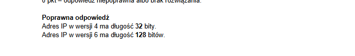

# Zestaw odpowiedzi do zadań

<br>
<br>

## Zadanie 1.1
A(32, 32) = 
**A(64, 16)** =
**A(128, 8)** =
**A(256, 4)** =
**A(512, 2)** =
**A(1024, 1)** = 1024

A(10, 15) =
2  * **A(10, 7)** + 10 =
2 * (2 * **A(10, 3)** + 10) + 10 =
2 * (2 * (2 * **A(10, 1)** + 10) + 10) + 10 = 150

A(1.2^100) - zawsze wchodzi w warunek 2 * A(m, n-1/2) + m co skutkuje 100 wywołaniami


<br>
<br>


## Zadanie 2.1
88765 + 11111 =

```text
    8 8 7 6 5
+   1 1 1 1 1
-------------
    9 9 8 7 6    
```

a więc 0 przeniesień

456789 + 222222 =
```text
        1 1 1 
    4 5 6 7 8 9
+   2 2 2 2 2 2
---------------
    6 7 9 0 1 1  
```

a więc 3 przeniesienia


<br>
<br>

## Zadanie 5

(**1440**)<sub>5</sub> to (**245**)<sub>10</sub> bo: <br>
Pierwsza liczba od lewej (1): 1 * 5<sup>3</sup> = 125 <br>
Druga liczba od lewej (4): 4 * 5<sup>2</sup> = 100 <br>
Trzecia liczba od lewej (4): 4 * 5<sup>1</sup> = 20 <br>
Czwarta liczba od lewej (0): 0 * 5<sup>0</sup> = 0 <br>
125 + 100 + 20 + 0 = **245**

a mamy otrzymać (**427**)<sub>10</sub> więc musimy odjąć (**182**)<sub>10</sub>, ktore wynosi: (**1212**)<sub>5</sub> bo: <br>
Pierwsza liczba od lewej (1): 1 * 5 5<sup>3</sup> = 125 <br>
Druga liczba od lewej (2): 2 * 5<sup>2</sup> = 50 <br>
Trzecia liczba od lewej (1): 1 * 5<sup>1</sup> = 5 <br>
Czwarta liczba od lewej (2): 2 * 5<sup>0</sup> = 2 <br>
125 + 50 + 5 + 2 = **182** <br>

(110002)<sub>3</sub> to (**342**)<sub>10</sub> bo: <br>
Pierwsza liczba od lewej (1): 1 * 3<sup>5</sup> = 243 <br>
Druga liczba od lewej (1): 1 * 3<sup>4</sup> = 81 <br>
Trzecia liczba od lewej (0): 0 * 3<sup>3</sup> = 0 <br>
Czwarta liczba od lewej (0): 0 * 3<sup>2</sup> = 0 <br>
Piąta liczba od lewej (0): 0 * 3<sup>1</sup> = 0 <br>
Szósta liczba od lewej (2): 2 * 3<sup>0</sup> = 2 <br>
243 + 81 + 0 + 0 + 0 + 2 = **326** <br>

a mamy otrzymać (**427**)<sub>10</sub> więc musimy odjąć te (**326**)<sub>10</sub>, od (**753**)<sub>10</sub> ktore wynosi: (**1000220**)<sub>3</sub> bo: <br>
Pierwsza liczba od lewej (1): 1 * 3<sup>6</sup> = 729 <br>
Druga liczba od lewej (0): 0 * 3<sup>5</sup> = 0 <br>
Trzecia liczba od lewej (0): 0 * 3<sup>4</sup> = 0 <br>
Czwarta liczba od lewej (0): 0 * 3<sup>3</sup> = 0 <br>
Piąta liczba od lewej (2): 2 * 3<sup>2</sup> = 18 <br>
Szósta liczba od lewej (2): 2 * 3<sup>1</sup> = 6 <br>
Siódma liczba od lewej (0): 0 * 3<sup>0</sup> = 0 <br>
729 + 0 + 0 + 0 + 18 + 6 + 0 = **342** <br>


(1440)<sub>5</sub> + (**1212**)<sub>5</sub> = (427)<sub>10</sub> = (**1000220**)<sub>3</sub> − (110002)<sub>3</sub>


<br>
<br>

## Zadanie 6

Adres IP w wersji 4 ma długość **32** bity (4 oktety po 8 bitów)
<br>
Adres IP w wersji 6 ma długość **128** bitów 

